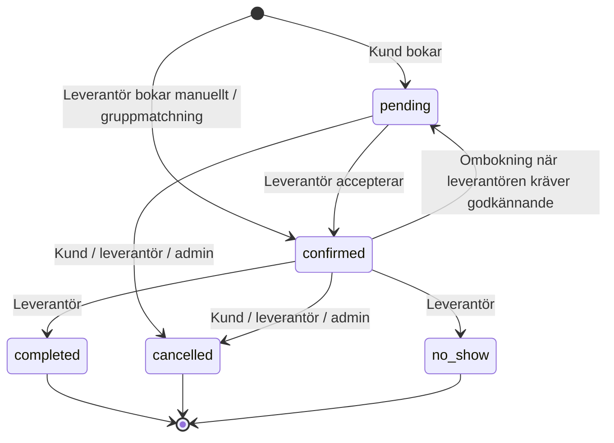

# Affärsregler -- katalog

> **Källa till sanning:** koden är det som faktiskt gäller, beslut i sprint- och
> beslutsdokument är det som *ska* gälla. Den här katalogen visar båda och var
> de skiljer sig. Inventerad read-only mot `main` (`566707e`) 2026-10-16. Ingen
> produktkod ändrades.

## Syfte och läsanvisning

Ett bokningssystem lever på att reglerna är förutsägbara för kund, leverantör
och utvecklare. Tidigare fanns reglerna utspridda i domänservices, routes,
Zod-scheman, Prisma-defaults, UI-komponenter, sprintdokument och hjälpartiklar.
Den här filen samlar dem på ett ställe.

Varje regel har:

- **ID** (`BR-<område>-<nr>`) -- stabilt. Referera ID:t i tester, PR:er och
  hjälpartiklar. Återanvänd aldrig ett borttaget ID.
- **Regel** -- i klartext, så som en kund eller leverantör upplever den.
- **Upprätthålls i** -- vilket lager som faktiskt stoppar ett brott (domän,
  route, databas, endast UI).
- **Status**:

| Status | Betydelse |
|--------|-----------|
| `BESLUTAD` | Uttryckligt beslut finns och koden följer det |
| `IMPLICIT` | Finns bara i koden. Fungerar, men ingen har formellt beslutat regeln -- bekräfta eller ändra |
| `AVVIKELSE` | Kod, beslut, docs eller hjälptext säger olika saker. Se [Avvikelser att åtgärda](#avvikelser-att-åtgärda) |
| `ÖPPEN` | Ingen regel finns. Kräver produktbeslut. Se [Öppna produktbeslut](#öppna-produktbeslut) |

**Best practice för nya regler:** en affärsregel ska upprätthållas i
domänlagret (eller databasen), aldrig bara i UI. API:t är det verkliga
kontraktet -- iOS, offline-kö och framtida integrationer går förbi webb-UI:t.

---

## Ordlista

Ersätter den arkiverade `docs/archive/UBIQUITOUS_LANGUAGE.md` för de begrepp som
används här. Samma ord i kod, UI och samtal.

| Term (UI) | Kod | Betydelse |
|-----------|-----|-----------|
| Kund | `User` (`userType: customer`) | Hästägare som bokar |
| Leverantör | `Provider` | Företag som utför tjänster (hovslagare, veterinär m.fl.) |
| Spökkund / manuell kund | `User.isManualCustomer` | Kundprofil skapad av leverantör, saknar inloggning. Kan slås ihop med riktigt konto |
| Tjänst | `Service` | Det som bokas. Har pris, längd och ev. rekommenderat intervall |
| Bokning | `Booking` | En tjänst hos en leverantör ett visst datum och tidsspann |
| Väntande | `pending` | Kundens bokning, inväntar leverantörens svar |
| Bekräftad | `confirmed` | Leverantören har accepterat |
| Genomförd | `completed` | Leverantören har markerat tjänsten utförd |
| Avbokad | `cancelled` | Avbruten av kund, leverantör, admin eller serie/grupp |
| Uteblev | `no_show` | Kunden var inte på plats |
| Flexibel beställning | `RouteOrder` | Kund anger datumspann i stället för tid, leverantören planerar in |
| Rutt-annons | `RouteOrder` (leverantörsskapad) | Leverantör annonserar att den är i ett område under en period |
| Serie | `BookingSeries` | Återkommande bokningar med fast intervall |
| Gruppbokning | `GroupBookingRequest` | Flera kunder på samma plats delar på ett besök |
| Ombokning | `reschedule` | Kunden flyttar sin bokning själv |
| Stängd dag | `AvailabilityException.isClosed` | Leverantören tar inte bokningar ett visst datum |
| Öppettider | `AvailabilitySchedule` | Veckoschema per veckodag |

---

## Aktörer och behörigheter

| ID | Regel | Upprätthålls i | Status |
|----|-------|----------------|--------|
| BR-AKT-01 | Kunden kan bara avboka sin bokning. Bekräfta, slutföra och markera uteblev kan bara leverantören göra | Domän: `BookingService.ts:225` (`PROVIDER_ONLY_STATUSES`), `:389` | `IMPLICIT` |
| BR-AKT-02 | En kund eller leverantör kan bara se och ändra sina egna bokningar | Repository: atomisk `WHERE` med `customerId`/`providerId` (`updateStatusWithAuth`, `deleteWithAuth`) | `BESLUTAD` (säkerhetsregel) |
| BR-AKT-03 | En leverantör kan inte boka sin egen tjänst som kund | Domän: `BookingService.ts` steg 3 (`SELF_BOOKING`) | `IMPLICIT` |
| BR-AKT-04 | Admin kan avboka bokningar som är väntande eller bekräftade | Route: `api/admin/bookings/route.ts:118` (Prisma direkt, förbi domänen) | `IMPLICIT` |
| BR-AKT-05 | Admin kan ta bort recensioner (båda riktningar). Loggas som säkerhetshändelse | Route: `api/admin/reviews/[id]/route.ts` | `IMPLICIT` |

---

## Bokning -- livscykel

| ID | Regel | Upprätthålls i | Status |
|----|-------|----------------|--------|
| BR-LIV-01 | Tillåtna övergångar enligt diagrammet. `completed`, `cancelled` och `no_show` är slutstatusar | Domän: `BookingStatus.ts:21` | `BESLUTAD` |
| BR-LIV-02 | Ombokning med `rescheduleRequiresApproval` flyttar `confirmed` tillbaka till `pending`. Sker förbi statusmaskinen | Domän: `BookingService.ts:641` | `IMPLICIT` -- dokumentera i `BookingStatus` |
| BR-LIV-03 | Leverantören kan markera `completed` eller `no_show` när som helst, även före bokad tid | Ingen tidskontroll | `AVVIKELSE` -- beslutat att förhindra (readiness C3) |
| BR-LIV-04 | Endast `pending` och `confirmed` räknas som upptagna vid krockkontroll | Repository: `createWithOverlapCheck` | `IMPLICIT` |

---

## Bokning -- skapa

Kundens bokning (`POST /api/bookings` → `BookingService.createBooking`). Kontrollerna körs i denna ordning:

| ID | Regel | Upprätthålls i | Status |
|----|-------|----------------|--------|
| BR-SKP-01 | Tjänsten måste vara aktiv och tillhöra vald leverantör | Domän: `BookingValidation.validateService` | `IMPLICIT` |
| BR-SKP-02 | Leverantören måste vara aktiv | Domän: `validateProvider` | `IMPLICIT` |
| BR-SKP-03 | Leverantör som stängt för nya kunder tar bara emot kunder med minst en **genomförd** bokning hos sig | Domän: `BookingService.ts:258` | `IMPLICIT` |
| BR-SKP-04 | Bokning går inte på en stängd dag (`AvailabilityException.isClosed`) | Domän: `validateClosedDay` | `IMPLICIT` |
| BR-SKP-05 | Bokning ska ligga inom leverantörens öppettider (veckoschema + avvikande tider) | **Endast i slot-API:t** (`api/providers/[id]/availability`) som UI:t använder. `createBooking` kontrollerar inte veckoschema eller avvikande öppettider | `AVVIKELSE` |
| BR-SKP-06 | Sluttid räknas från tjänstens längd om den inte skickas med. Starttid måste vara före sluttid | Domän: `validateTimeSlot` / `TimeSlot` | `IMPLICIT` |
| BR-SKP-07 | Datum får inte vara passerat. Kontrollen gäller datum, inte klockslag -- en tid tidigare samma dag accepteras | Route: Zod i `api/bookings/route.ts:40` | `AVVIKELSE` (passerad tid i dag tillåts) |
| BR-SKP-08 | Bokning mot rutt-annons kräver att annonsen är `open`, tillhör samma leverantör och att datumet ligger inom annonsens spann | Domän: `validateRouteOrder` | `IMPLICIT` |
| BR-SKP-09 | Restid: det måste finnas tid för resa mellan leverantörens bokningar samma dag. Restid = fågelväg × 1,2 vid 50 km/h, plus **minst 60 min buffert**. Saknas plats används 60 min | Domän: `TravelTimeService.ts:65-69`. Plats: kundens adress, annars leverantörens hemadress | `IMPLICIT` -- `booking-flow.md` anger fel värden (10/15 min) |
| BR-SKP-10 | Ingen krock med leverantörens väntande/bekräftade bokningar. Kontrollen är atomisk (Serializable-transaktion) | Repository: `createWithOverlapCheck` | `BESLUTAD` |
| BR-SKP-11 | En kunds bokning startar som `pending` | Repository-default | `BESLUTAD` |
| BR-SKP-12 | Hästen som anges (`horseId`) ska tillhöra kunden | **Ingen kontroll hittad** i route eller domän | `AVVIKELSE` -- verifiera (säkerhet) |
| BR-SKP-13 | Max 10 bokningsförsök per timme | Route: rate limiter | `IMPLICIT` |
| BR-SKP-14 | Priset som gäller för bokningen | **Sparas inte** på bokningen. Betalning tar tjänstens *aktuella* pris | `ÖPPEN` -- se ÖB-04 |
| BR-SKP-15 | Samma leverantör, datum, start- och sluttid får bara finnas en gång | Databas: unikt index `Booking_providerId_bookingDate_startTime_endTime_key` (gäller **alla** statusar, även avbokade) | `AVVIKELSE` -- se AV-02 |

---

## Manuell bokning

Leverantören bokar åt en kund (`POST /api/bookings/manual`).

| ID | Regel | Upprätthålls i | Status |
|----|-------|----------------|--------|
| BR-MAN-01 | Startar direkt som `confirmed` | Domän: `createManualBooking` | `IMPLICIT` |
| BR-MAN-02 | Ingen restidskontroll och ingen kontroll av "stängt för nya kunder". Stängd dag och krock kontrolleras | Domän | `IMPLICIT` -- medvetet? Bekräfta |
| BR-MAN-03 | Kunden måste vara "nåbar" för leverantören: kopplad via kundregister, en okopplad spökkund, eller tidigare genomförd/uteblev-bokning hos leverantören. Annars 403 | Domän: `isCustomerReachable` (fail-closed) | `BESLUTAD` (säkerhetsfix C2) |
| BR-MAN-04 | Anges bara namn skapas en spökkund som kan slås ihop med ett riktigt konto senare (oåterkalleligt) | Domän: `GhostMergeService` | `IMPLICIT` |

---

## Ombokning

Kunden flyttar själv (`POST /api/bookings/[id]/reschedule`). Leverantören styr via profilinställningar.

| ID | Regel | Upprätthålls i | Status |
|----|-------|----------------|--------|
| BR-OMB-01 | Endast kunden som äger bokningen kan boka om | Domän | `BESLUTAD` |
| BR-OMB-02 | Endast `pending` och `confirmed` kan bokas om | Domän | `IMPLICIT` |
| BR-OMB-03 | Leverantören kan stänga av självservice-ombokning (`rescheduleEnabled`, default på) | Domän + `Provider`-schema | `IMPLICIT` |
| BR-OMB-04 | Ombokning måste ske minst `rescheduleWindowHours` före bokad tid (default **24 h**) | Domän: `BookingService.ts:593`. Tiden tolkas i serverns tidszon (UTC), inte `Booking.timezone` -- i Sverige blir fönstret 1-2 h för generöst | `AVVIKELSE` (tidszon) |
| BR-OMB-05 | Max `maxReschedules` ombokningar per bokning (default **2**) | Domän + `Booking.rescheduleCount` | `IMPLICIT` |
| BR-OMB-06 | Leverantören kan kräva godkännande (`rescheduleRequiresApproval`, default av) -- då går bokningen tillbaka till `pending` | Domän | `IMPLICIT` |
| BR-OMB-07 | Ny tid: tjänsten måste fortfarande vara aktiv, datum ej passerat, ingen stängd dag, ingen krock | Domän | `IMPLICIT` |
| BR-OMB-08 | Vid ombokning kontrolleras **inte** restid eller öppettider (till skillnad från ny bokning) | -- | `AVVIKELSE` -- bör vara samma regler som BR-SKP |

Hjälpartikeln `customer/hantera-bokningar.md` nämner att funktionen finns men inte 24 h-gränsen eller maxantalet.

---

## Avbokning och borttagning

| ID | Regel | Upprätthålls i | Status |
|----|-------|----------------|--------|
| BR-AVB-01 | Kund och leverantör kan avboka `pending` och `confirmed`. Valfritt meddelande, max 500 tecken | Domän + route `PUT /api/bookings/[id]` | `IMPLICIT` |
| BR-AVB-02 | Kunden kan avboka **när som helst**, även strax före besöket | Ingen tidsgräns i kod. Användarvillkoren anger 24 h | `AVVIKELSE` (readiness R3) |
| BR-AVB-03 | Betald bokning kan inte avbokas | **Endast UI** (`BookingCard.tsx`). API:t tillåter det | `AVVIKELSE` |
| BR-AVB-04 | Avbokning och återbetalning är separata processer. Avbokning före betalning ger ingen återbetalning | Beslut: readiness-sprinten | `BESLUTAD` |
| BR-AVB-05 | Avgift vid sen avbokning eller uteblev | Finns inte | `ÖPPEN` (uttryckligen ej beslutad) |
| BR-AVB-06 | `DELETE /api/bookings/[id]` **raderar** bokningen permanent för ägande kund eller leverantör, oavsett status. Betalning, recension och konversation raderas med (cascade) | Repository: `deleteWithAuth`. Webb-UI:t använder inte endpointen | `AVVIKELSE` -- se AV-01 |

---

## Återkommande bokningar

Feature flag `recurring_bookings`. `BookingSeriesService`.

| ID | Regel | Upprätthålls i | Status |
|----|-------|----------------|--------|
| BR-SER-01 | Leverantören kan stänga av serier (`recurringEnabled`, default på) | Domän | `IMPLICIT` |
| BR-SER-02 | Intervall 1-52 veckor | Domän: `BookingSeriesService.ts:148` | `IMPLICIT` |
| BR-SER-03 | Minst 2 och högst `maxSeriesOccurrences` tillfällen (default **12**) | Domän | `IMPLICIT` |
| BR-SER-04 | Varje tillfälle valideras som en vanlig bokning. Datum som krockar eller är stängda **hoppas över** och rapporteras -- serien skapas ändå om minst ett tillfälle lyckas | Domän | `IMPLICIT` |
| BR-SER-05 | Avbryts serien avbokas framtida `pending`/`confirmed` tillfällen. Redan passerade lämnas | Domän: `cancelSeries`. Jämför `bookingDate >= nu` -- ett tillfälle **i dag** avbokas inte | `AVVIKELSE` (kantfall) |
| BR-SER-06 | Både kund och leverantör i serien kan avbryta den | Domän | `IMPLICIT` |

---

## Gruppbokningar

Feature flag `group_bookings`. `GroupBookingService`.

| ID | Regel | Upprätthålls i | Status |
|----|-------|----------------|--------|
| BR-GRP-01 | Status: `open` → `matched` → `completed`, samt `open`/`matched` → `cancelled` | Domän: `VALID_STATUS_TRANSITIONS` | `IMPLICIT` |
| BR-GRP-02 | 2-20 deltagare, 1-10 hästar per deltagare | Route: Zod | `IMPLICIT` |
| BR-GRP-03 | Gå med kräver: gruppen `open`, deadline ej passerad, inte redan med, inte full | Domän | `IMPLICIT` |
| BR-GRP-04 | Bara skaparen kan ändra eller avbryta gruppen. Deltagare kan lämna själva, skaparen kan ta bort deltagare | Domän | `IMPLICIT` |
| BR-GRP-05 | Lämnar sista deltagaren avbryts gruppen automatiskt | Domän | `IMPLICIT` |
| BR-GRP-06 | Vid matchning skapas en `confirmed` bokning per deltagare, i följd utan mellanrum | Repository: `matchAndCreateBookings` skriver direkt med Prisma -- **förbi** krockkontroll, stängd dag, öppettider och restid (bara databasens unika index) | `AVVIKELSE` |
| BR-GRP-07 | Avbryts en **matchad** grupp avbokas inte de skapade bokningarna | Domän/repository uppdaterar bara gruppens status | `AVVIKELSE` -- bekräfta önskat beteende |

---

## Betalning

Beslut och fullständig analys finns i [customer-purchase-readiness-2026-10.md](../sprints/customer-purchase-readiness-2026-10.md)
och [payment-marketplace-model-decision.md](payment-marketplace-model-decision.md). Här listas bara reglerna.

| ID | Regel | Upprätthålls i | Status |
|----|-------|----------------|--------|
| BR-BET-01 | Kunden betalar **efter** utförd tjänst: endast `completed` är betalbar | Beslut 2026-10. Koden tillåter `confirmed` och `completed` (`PaymentService.ts:129`). Hjälpartikeln `customer/betalning-och-kvitto.md` säger "bekräftad eller genomförd" | `AVVIKELSE` (readiness C2) |
| BR-BET-02 | Belopp styrs av servern (tjänstens pris), SEK | Domän | `BESLUTAD` |
| BR-BET-03 | En bokning kan bara betalas en gång | Domän (`ALREADY_PAID`) + `Payment.bookingId` unikt | `BESLUTAD` |
| BR-BET-04 | En betalningsstart per bokning (ingen dubbeldebitering vid omförsök) | Saknar idempotency key | `AVVIKELSE` (readiness C1) |
| BR-BET-05 | Webhook-händelser behandlas en gång och status går bara framåt (`succeeded`/`failed` är slutstatus) | Domän: `PaymentWebhookService` (atomisk `updateMany`) | `BESLUTAD` |
| BR-BET-06 | Kvittonummer `EQ-YYYYMM-XXXXXX` | `InvoiceNumberGenerator.ts` | `IMPLICIT` (`booking-flow.md` anger fel format) |
| BR-BET-07 | Återbetalning gäller bara genomförd betalning (feldebitering, reklamation, godkänt undantag) | Beslut. Ingen kod finns | `BESLUTAD`, ej implementerad (readiness D4) |
| BR-BET-08 | Vem som är säljare, momsansvar, utbetalning till leverantör, plattformsavgift | -- | `ÖPPEN` (readiness D1, blockerar livebetalning) |

---

## Recensioner

| ID | Regel | Upprätthålls i | Status |
|----|-------|----------------|--------|
| BR-REC-01 | Kunden kan recensera leverantören bara för en **genomförd** bokning, en gång per bokning | Domän: `ReviewService.ts:103-117` + `Review.bookingId` unikt | `IMPLICIT` |
| BR-REC-02 | Leverantören kan recensera kunden på samma villkor | Domän: `CustomerReviewService` | `IMPLICIT` |
| BR-REC-03 | Betyg 1-5, kommentar max 500 tecken | Route: Zod | `IMPLICIT` |
| BR-REC-04 | Leverantören kan svara en gång per recension och ta bort sitt svar | Domän | `IMPLICIT` |
| BR-REC-05 | Kunden kan ändra och ta bort sin recension **utan tidsgräns** | Route: `api/reviews/[id]` (repository direkt) | `ÖPPEN` -- bekräfta |

---

## Meddelanden

| ID | Regel | Upprätthålls i | Status |
|----|-------|----------------|--------|
| BR-MED-01 | En konversation per bokning, mellan bokningens kund och leverantör | Schema + domän | `IMPLICIT` |
| BR-MED-02 | Stängd för nya meddelanden om bokningen är `cancelled` eller `no_show`, eller mer än **30 dagar** efter `completed` | Domän: `ConversationService.ts:64-71` | `IMPLICIT` |
| BR-MED-03 | Bilagor: JPEG/PNG/HEIC/WebP, max 10 MB, typ verifieras via filinnehåll | `messaging-constants.ts`, `supabase-storage.ts` | `BESLUTAD` |

---

## Påminnelser och serviceintervall

| ID | Regel | Upprätthålls i | Status |
|----|-------|----------------|--------|
| BR-PÅM-01 | Kunden får en påminnelse ca 24 h före en **bekräftad** bokning (fönster 22-30 h), högst en per bokning | Domän: `BookingReminderService` (cron) | `IMPLICIT` |
| BR-PÅM-02 | Serviceintervall för en häst: kundens eget intervall går före leverantörens rekommendation, som går före tjänstens standard | Domän: `DueForServiceCalculator.resolveInterval` | `IMPLICIT` |
| BR-PÅM-03 | Status "försenad" när intervallet passerats, "snart" inom **14 dagar** | Domän: `DueForServiceCalculator.ts:26` | `IMPLICIT` |

---

## Konto, GDPR och dataretention

| ID | Regel | Upprätthålls i | Status |
|----|-------|----------------|--------|
| BR-KTO-01 | Konto raderas genom anonymisering. Bokningar och recensioner sparas anonymiserat (kommentarer och kundanteckningar rensas), hästar och personliga poster raderas. Admin-konton kan inte raderas själv | Domän: `AccountDeletionService` | `IMPLICIT` |
| BR-KTO-02 | Vid radering hanteras inte kommande `pending`/`confirmed` bokningar -- de ligger kvar hos motparten | -- | `ÖPPEN` -- se ÖB-06 |
| BR-KTO-03 | Uppladdade filer tas bort ur lagringen vid radering | `deleteStorageFiles` **loggar bara** sökvägarna | `AVVIKELSE` (GDPR) |
| BR-KTO-04 | Konto inaktivt i **2 år** varnas och raderas efter **30 dagars** frist | Domän: `DataRetentionService.ts:59-60` (feature flag `data_retention`) | `IMPLICIT` |
| BR-KTO-05 | Sammanslagning av spökkund in i riktigt konto är oåterkallelig. Målkontot får inte vara en spökkund | Domän: `GhostMergeService` | `IMPLICIT` |

---

## Övriga domäner

| ID | Regel | Upprätthålls i | Status |
|----|-------|----------------|--------|
| BR-ÖVR-01 | Stallinbjudan gäller i 7 dagar och kan användas en gång | Domän: `StableInviteService.ts:27` | `IMPLICIT` |
| BR-ÖVR-02 | Leverantörsprenumeration räknas som avslutad vid `canceled` eller `incomplete_expired` | Domän: `SubscriptionService.ts:24` | `IMPLICIT` |
| BR-ÖVR-03 | Om en leverantör utan aktiv prenumeration ska kunna ta emot bokningar | Prenumeration styr inte bokningsbarhet idag | `ÖPPEN` |
| BR-ÖVR-04 | Admin-session upphör efter 15 min | `roles.ts` | `IMPLICIT` |

---

## Avvikelser att åtgärda

Fynd från inventeringen, sorterade efter risk. Inget är åtgärdat -- varje rad
är en kandidat till egen slice. Prioriteringsskala som i readiness-sprinten
(P0 blockerar skarpa kunder, P1 före bred lansering, P2 förbättring).

| ID | Fynd | Risk | Förslag | Prio |
|----|------|------|---------|------|
| AV-01 | `DELETE /api/bookings/[id]` hårdraderar bokning i alla statusar, inkl. betalda och genomförda. Betalningsrad, recension och konversation följer med (cascade). Webb-UI:t använder den inte, men API:t är öppet för ägande kund/leverantör | Förlorad betalnings- och bokföringshistorik, raderade recensioner | Ta bort endpointen eller begränsa till `pending` utan betalning; byt `Payment` till `onDelete: Restrict` | P0 |
| AV-02 | Unikt index på (leverantör, datum, start, slut) gäller även avbokade bokningar. Efter en avbokning kan exakt samma tid inte bokas igen -- API:t svarar 409 "Bokningen finns redan" | Lediga tider går inte att boka; gäller även ombokning och serier | Ersätt med partiellt unikt index `WHERE status IN ('pending','confirmed')`. Verifiera först mot databasen och med integrationstest | P1 |
| AV-03 | Betalning tillåts vid `confirmed` (BR-BET-01) | Kunden betalar innan tjänsten är utförd | Readiness C2 + hjälpartikel | P0 |
| AV-04 | `completed`/`no_show` kan sättas före bokad tid (BR-LIV-03) | Felaktig status, för tidig betalning | Readiness C3 | P0 |
| AV-05 | Betald bokning kan avbokas via API:t (BR-AVB-03) | Betald men avbokad bokning utan återbetalningsflöde | Flytta regeln till `BookingService.updateStatus` | P1 |
| AV-06 | Ingen kontroll att `horseId` tillhör kunden vid bokning (BR-SKP-12) | Möjlig koppling till annan kunds häst. Behöver verifieras: vad leverantören då kan se av hästen | Ägarkontroll i domänen + säkerhetsgranskning | P1 |
| AV-07 | Öppettider kontrolleras inte i API:t (BR-SKP-05), inte heller vid ombokning (BR-OMB-08) eller gruppmatchning (BR-GRP-06) | Bokningar utanför arbetstid via iOS/API eller direkta anrop | En gemensam valideringsfunktion som alla bokningsvägar använder | P1 |
| AV-08 | Gruppmatchning skriver bokningar förbi `BookingService` (BR-GRP-06) | Krockar och stängda dagar missas | Låt matchning gå via domänvalideringen | P1 |
| AV-09 | Ombokningsfönstret räknas i UTC (BR-OMB-04) | Gränsen 24 h blir 22-23 h i praktiken | Räkna i `Booking.timezone` (Europe/Stockholm). Test med sommar- och vintertid | P2 |
| AV-10 | Datumkontrollen släpper igenom passerad tid i dag (BR-SKP-07) | Bokning bakåt i tiden samma dag | Jämför datum + starttid i svensk tid | P2 |
| AV-11 | Avbruten serie lämnar dagens tillfälle (BR-SER-05) | Kund tror att allt är avbokat | Jämför mot dagens datum, inte nuvarande klockslag | P2 |
| AV-12 | Avbruten matchad grupp lämnar bokningarna kvar (BR-GRP-07) | Leverantören åker ut i onödan | Beslut + avboka kopplade bokningar | P2 |
| AV-13 | Lagrade filer raderas inte vid kontoradering (BR-KTO-03) | GDPR Art. 17 | Implementera Storage-borttagning | P1 |
| AV-14 | `booking-flow.md` är inaktuell: låtsasbetalning, Stripe som "nästa steg", fel buffertvärden (10/15 i stället för 60/60 min), fel kvittoformat, saknar `no_show`. `docs/api/bookings.md` saknar också `no_show` | Vilseledande dokumentation | Skriv om eller arkivera; den här katalogen är referensen för reglerna | P2 |
| AV-15 | Hjälpartiklar saknar regler som påverkar kunden: ombokningsgräns 24 h / max 2, när betalning är möjlig, att avbokning är fri | Kunden blir överraskad | Uppdatera `customer/hantera-bokningar.md` och `customer/betalning-och-kvitto.md` när reglerna beslutats | P1 |

**Metod och begränsningar:** Fynden bygger på läsning av kod och migrationer,
inte på körning mot databas. AV-02 och AV-06 bör bekräftas med ett
integrationstest innan de åtgärdas. Inventeringen täcker bokning, betalning,
recensioner, meddelanden, påminnelser, konto och stickprov på övriga domäner.
Ruttplanering, röstloggning, Fortnox och iOS-specifika flöden är inte
genomgångna.

---

## Öppna produktbeslut

Frågor där ingen regel finns. Kräver Johans beslut innan de kan implementeras.

| ID | Fråga | Varför det spelar roll | Koppling |
|----|-------|------------------------|----------|
| ÖB-01 | Avbokningsgräns för kunden? Fast (t.ex. 24 h, som villkoren säger) eller per leverantör, som ombokning? | Villkor och kod motsäger varandra idag | BR-AVB-02, readiness D2 |
| ÖB-02 | Avgift vid sen avbokning eller uteblev? | Leverantörens intäktsrisk | BR-AVB-05, readiness R3 §6 |
| ÖB-03 | Säljarmodell, moms, utbetalning, plattformsavgift | Blockerar livebetalning | BR-BET-08, readiness D1 |
| ÖB-04 | Ska priset låsas vid bokning? Får leverantören justera priset på plats (fler hovar, akut åtgärd)? | Idag betalar kunden det pris som gäller vid betalningstillfället, inte vid bokning. Konsumenträttsligt och för förtroende bör det överenskomna priset sparas på bokningen | BR-SKP-14 |
| ÖB-05 | Hur länge får kunden ändra eller ta bort en recension? | Recensioner kan ändras i efterhand utan spår | BR-REC-05 |
| ÖB-06 | Vad händer med kommande bokningar när en kund eller leverantör raderar sitt konto? | Leverantören kan åka till en anonymiserad kund, kund kan ha bokning hos raderad leverantör | BR-KTO-02 |
| ÖB-07 | Ska manuella bokningar respektera restid och "stängt för nya kunder"? | Leverantören kan dubbelboka sig själv geografiskt | BR-MAN-02 |
| ÖB-08 | Ska leverantör utan aktiv prenumeration kunna ta emot bokningar? | Affärsmodell | BR-ÖVR-03 |

---

## Underhåll av katalogen

- **Ny eller ändrad regel:** uppdatera raden här i samma PR som koden. En
  regel med status `IMPLICIT` som någon bekräftar blir `BESLUTAD` -- notera
  datum i [decision-log.md](../decision-log.md).
- **Tester:** namnge eller kommentera tester med regel-ID
  (`it('BR-OMB-04: rejects reschedule within window', ...)`) så att
  `grep BR-OMB-04` visar både regel och bevis.
- **Hjälpartiklar:** en regel som påverkar vad kunden eller leverantören kan
  göra ska finnas i relevant hjälpartikel. Ange regel-ID i en
  HTML-kommentar i artikeln.
- **Placering:** regler ska upprätthållas i domänlagret. "Endast UI" är alltid
  en avvikelse.
- **Konfigurerbara regler:** värden som leverantören kan ändra (fönster,
  maxantal) ska ha default i schemat och beskrivas här med default-värdet.
